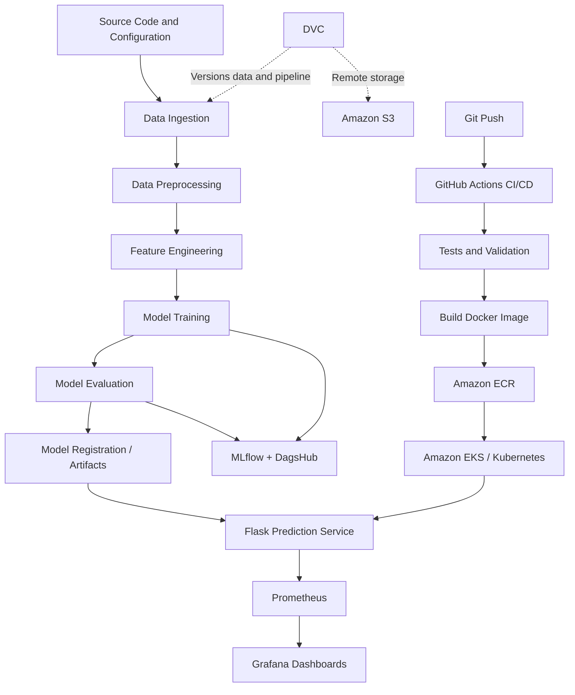

<div align="center">

# 🚀 MLOps Atlas

### An End-to-End Machine Learning Lifecycle Platform

**From reproducible experiments to automated cloud deployment and production observability.**

<p>
  
  
  
  
  
  
</p>

</div>

---

## 📌 Overview

**MLOps Atlas** is an end-to-end MLOps project designed to bring machine learning workflows closer to production engineering practices. It connects data and pipeline versioning, experiment tracking, model evaluation, containerization, continuous integration and delivery, cloud deployment, and monitoring into one workflow.

Rather than treating model training as the finish line, MLOps Atlas focuses on the engineering around a model: **reproducibility, automation, deployment consistency, and visibility into a running service.**

The platform uses **MLflow and DagsHub** for experiment tracking, **DVC and Amazon S3** for versioning and remote artifact storage, **Flask** for model serving, **Docker** for packaging, **GitHub Actions** for CI/CD, **Amazon ECR and Amazon EKS** for container delivery and Kubernetes deployment, and **Prometheus with Grafana** for observability.

## 🎯 Project Goals

- Build a reproducible machine learning pipeline with clearly separated stages.
- Track experiments and evaluation metrics to support evidence-based model selection.
- Version data and pipeline artifacts without storing large files directly in Git.
- Package the prediction service in a consistent, portable Docker image.
- Automate testing and delivery through a CI/CD workflow.
- Deploy the containerized application to a managed Kubernetes environment on AWS.
- Collect service metrics and visualize operational behavior through monitoring dashboards.
- Keep credentials and environment-specific configuration outside source code.

## 🧰 Technology Stack

| Area | Technologies | Purpose |
|---|---|---|
| Language | Python 3.10 | ML pipeline and application logic |
| Project structure | Cookiecutter Data Science | Organized, maintainable project layout |
| Experiment tracking | MLflow, DagsHub | Track runs, parameters, metrics, and artifacts |
| Data and pipeline versioning | DVC | Reproducible stages and data version control |
| Artifact storage | Amazon S3 | Remote storage for DVC-managed artifacts |
| Model serving | Flask | HTTP interface for model predictions |
| Containerization | Docker | Reproducible application packaging |
| CI/CD | GitHub Actions | Automated validation and image delivery |
| Container registry | Amazon ECR | Store versioned container images |
| Cloud infrastructure | AWS | Cloud resources and deployment foundation |
| Orchestration | Amazon EKS, Kubernetes | Deploy and manage application workloads |
| Metrics | Prometheus | Scrape and store operational metrics |
| Dashboards | Grafana | Visualize metrics and service health |
| Testing | pytest | Automated application and pipeline tests |

## 🏗️ Architecture



> **Architecture note:** The diagram represents the intended end-to-end workflow. Exact connections between model artifacts, the CI/CD pipeline, the deployment manifests, and monitoring depend on the repository configuration.

## 🔄 Workflow

### 1. Data and pipeline management
The ML workflow is organized into separate stages for ingestion, preprocessing, feature engineering, model building, evaluation, and model registration. DVC tracks pipeline dependencies and supports reproducible execution.

### 2. Experiment tracking
MLflow, integrated with DagsHub, records experiment parameters, metrics, and artifacts so that model runs can be compared and evaluated systematically.

### 3. Remote artifact storage
Amazon S3 is configured as a DVC remote for versioned data and pipeline artifacts. Git remains focused on source code and lightweight configuration.

### 4. Model serving
A Flask application exposes the trained model through an HTTP interface, separating prediction serving from experimentation and training code.

### 5. Containerization
Docker packages the application and its runtime dependencies into an image, reducing environment differences between development and deployment.

### 6. Continuous integration and delivery
GitHub Actions runs the configured validation and delivery workflow. The pipeline is designed to test the code, build a Docker image, and publish the image to Amazon ECR.

### 7. Kubernetes deployment
Amazon EKS provides the managed Kubernetes environment for deploying the application. Kubernetes resources define how the workload runs and how it is exposed.

### 8. Monitoring and observability
Prometheus collects configured metrics, while Grafana provides dashboards for inspecting application and infrastructure behavior. Monitoring coverage depends on the metrics exposed by the application and configured scrape targets.

## 📁 Project Structure

The exact tree may evolve as implementation progresses. A recommended layout for MLOps Atlas is:

```text
mlops-atlas/
├── .github/
│   └── workflows/
│       └── ci.yaml
├── flask_app/
│   ├── app.py
│   ├── requirements.txt
│   └── templates/
├── notebooks/
├── data/
│   ├── raw/
│   ├── interim/
│   └── processed/
├── models/
├── reports/
│   └── figures/
├── scripts/
├── src/
│   └── model/
│       ├── __init__.py
│       ├── logger.py
│       ├── data_ingestion.py
│       ├── data_preprocessing.py
│       ├── feature_engineering.py
│       ├── model_building.py
│       ├── model_evaluation.py
│       └── register_model.py
├── tests/
├── dvc.yaml
├── params.yaml
├── Dockerfile
├── requirements.txt
├── .gitignore
└── README.md
```

Kubernetes manifests, Prometheus configuration, Grafana dashboard definitions, and infrastructure configuration can be added in dedicated folders as the deployment setup grows.

## ⚙️ Getting Started

### Prerequisites

Install or configure the tools needed for the parts of the project you intend to run:

- Python 3.10
- Git
- Conda or another Python environment manager
- Docker Desktop or Docker Engine
- DVC and the required storage integration
- AWS CLI with appropriately scoped permissions
- Access to the configured DagsHub repository
- For cloud deployment: `kubectl`, `eksctl`, and access to an AWS account with the required permissions

### 1. Clone the repository

```bash
git clone <your-repository-url>
cd mlops-atlas
```

### 2. Create the Python environment

```bash
conda create -n atlas python=3.10 -y
conda activate atlas
```

### 3. Install dependencies

Install the dependencies defined by the repository:

```bash
pip install -r requirements.txt
```

If the Flask application maintains a separate dependency file, install those dependencies from its directory as well.

### 4. Configure credentials securely

Configure the AWS CLI using an approved credential method:

```bash
aws configure
```

Set up the MLflow/DagsHub tracking configuration and DVC remote according to the repository's environment settings.

**Security requirements:**
- Never commit AWS access keys, DagsHub tokens, passwords, or other secrets.
- Store CI/CD credentials in GitHub Actions Secrets or use an appropriate AWS role-based identity setup.
- Keep local environment files out of Git using `.gitignore`.
- Grant each identity only the permissions it needs.
- If a credential has been shared publicly or committed accidentally, revoke or rotate it immediately.

### 5. Reproduce the pipeline

After the DVC configuration, data dependencies, and required credentials are in place:

```bash
dvc repro
dvc status
```

To upload tracked artifacts to the configured remote:

```bash
dvc push
```

### 6. Run the prediction service locally

From the application directory, install its dependencies and start the Flask app using the entry point configured in the repository. For example:

```bash
cd flask_app
python app.py
```

The exact startup command and prediction endpoint depend on the application implementation.

### 7. Build and run the Docker image

From the repository root:

```bash
docker build -t mlops-atlas:latest .
docker run --rm -p 8888:5000 mlops-atlas:latest
```

This example maps port `8888` on your machine to port `5000` in the container. If the application requires environment variables, supply them at runtime through a secure local configuration rather than hard-coding secrets into the image.

### 8. Deploy to AWS

The cloud deployment workflow uses Amazon ECR as the container registry and Amazon EKS as the Kubernetes runtime. Before deploying, configure the AWS region, registry, cluster, image references, IAM permissions, Kubernetes manifests, and required secrets for your environment.

Do not copy live credentials, account-specific identifiers, or temporary load-balancer URLs into this README.

## 📊 Experiment Tracking and Model Evaluation

MLOps Atlas is designed to make experiments easier to reproduce and compare.

The tracking workflow can record:

- Model and training parameters
- Evaluation metrics
- Run history and experiment comparisons
- Model artifacts and registration information
- References to the data and pipeline version used for a run

Evaluation metrics should be interpreted in the context of the dataset, validation strategy, and business or application requirements. No model-performance figures are claimed here because they should come directly from verified experiment results.

## 📈 Deployment and Monitoring

The deployment and monitoring layer is intended to support operational visibility after the model is served.

**Prometheus**
- Scrapes metrics from configured targets.
- Stores time-series metrics for querying and alerting.
- Helps investigate changes in application behavior.

**Grafana**
- Visualizes Prometheus metrics through dashboards.
- Helps inspect trends, availability signals, and configured service metrics.

**Kubernetes**
- Manages application pods and deployment state.
- Supports declarative deployments and workload recovery according to the configured specifications.
- Exposes the application through the selected Kubernetes Service.

Production readiness also requires meaningful health checks, suitable resource requests and limits, secure network rules, logging, and alerts appropriate to the service.

## 🧪 Testing and Quality

Automated tests belong in the `tests/` directory and can be integrated into GitHub Actions.

Recommended checks include:

- Unit tests for preprocessing and feature engineering
- Validation of model input and output formats
- Model artifact loading tests
- Flask endpoint tests
- Pipeline-stage validation
- Container build verification
- Deployment manifest validation

Run the tests configured in the repository with:

```bash
pytest
```

The command and coverage depend on the tests and test configuration currently present in the project.

## 🔐 Security and Responsible Cloud Usage

- Use environment variables, GitHub Actions Secrets, or role-based authentication for credentials.
- Do not commit `.env` files, private keys, tokens, or AWS credentials.
- Avoid exposing administrative services and monitoring dashboards directly to the public internet.
- Use least-privilege IAM policies and restrict inbound network access.
- Pin and review dependencies, and scan container images as part of the release process.
- Delete temporary AWS resources when they are no longer needed.
- Review AWS billing and resource usage after cloud experiments.

## 🗺️ Roadmap

- [x] Establish a structured ML project layout
- [x] Define the experiment tracking and data versioning approach
- [x] Plan modular data and model pipeline stages
- [x] Define the containerization and CI/CD approach
- [x] Plan Kubernetes deployment on Amazon EKS
- [x] Plan Prometheus and Grafana observability
- [ ] Verify the full workflow from data ingestion through deployment
- [ ] Add automated tests and pipeline validation for all critical stages
- [ ] Add reproducible deployment instructions and architecture evidence
- [ ] Document verified metrics, screenshots, and a live demo if available

> Update roadmap checkboxes as each capability is verified in the repository. The checkmarks above indicate foundational design/setup work described for the project, not independent verification that every production workflow is complete.

## 💡 Key Takeaways

MLOps Atlas brings together several important engineering practices in one learning project:

- **Reproducibility:** versioned data and repeatable pipeline stages.
- **Traceability:** experiment history, parameters, and evaluation metrics.
- **Automation:** a CI/CD workflow for validating and packaging changes.
- **Portability:** containerized model serving.
- **Cloud-native deployment:** Kubernetes-based application delivery on AWS.
- **Observability:** metrics collection and dashboards for the running service.
- **Security awareness:** externalized credentials and controlled cloud access.

## 👨‍💻 Author

Built as a hands-on project to deepen practical experience in machine learning engineering, MLOps, cloud deployment, automation, and production monitoring.

**Project:** MLOps Atlas  
**Focus:** Machine Learning Engineering · MLOps · AWS · Docker · Kubernetes · CI/CD

---

<div align="center">

**⭐ If you find this project useful, consider starring the repository.**

*Building reliable ML systems takes more than training a model—it takes a repeatable path to production.*

</div>
